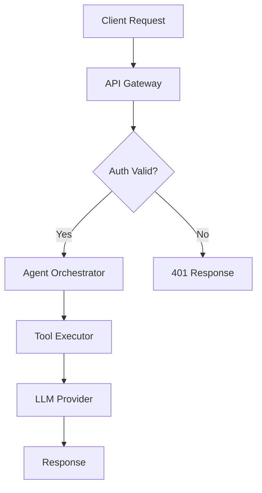

import Callout from "../../components/Callout.astro";

This publication uses MDX to embed interactive components directly in articles — executable code, live diagrams, and evaluatable expressions.

## Why MDX for Architecture?

Technical documentation benefits from _executable_ examples. Instead of showing a code snippet and its output separately, MDX lets us run the code and display results inline.

## Interactive Components

### Executable Code Blocks

```jsx
import { renderToString } from "react-dom/server";

function TokenCounter({ text }) {
  const tokens = text.split(/\s+/).length;
  return (
    <code>
      {tokens} tokens ≈ {Math.ceil(tokens / 1.3)} words
    </code>
  );
}

<TokenCounter text="This publication treats AI as a systems engineering discipline." />;
```

<Callout type="evidence">
  Token estimation runs client-side; zero server cost. Source:
  [token-estimator](https://github.com/example/token-estimator).
</Callout>

### Live Architecture Diagrams



<Callout type="decision">
  Mermaid diagrams render at build time via `@astrojs/mdx` + `rehype-mermaid`.
  Zero runtime JS.
</Callout>

### Evaluatable Expressions

```jsx
const budget = 100_000;
const used = 67_432;
const remaining = budget - used;
const pct = Math.round((used / budget) * 100);

<div
  style={{
    padding: "1rem",
    background: "var(--sheet-darker)",
    borderRadius: "var(--radius)",
  }}
>
  <strong>Budget:</strong> {budget.toLocaleString()} tokens
  <br />
  <strong>Used:</strong> {used.toLocaleString()} ({pct}%)
  <br />
  <strong>Remaining:</strong> {remaining.toLocaleString()}
</div>;
```

## Custom Components

Components live in `src/components/` and can be imported directly in MDX:

```mdx
import Callout from "../components/Callout.astro";

<Callout type="evidence">This claim is backed by data.</Callout>
```

Available components:

- `<Callout type="evidence|failure|migration|decision">` — Admonitions
- `<Diagram>` — Mermaid/PlantUML diagrams
- `<CodeBlock lang="rust" editable>` — Editable code playground

## References

- [MDX Specification](https://mdxjs.com/docs/what-is-mdx)
- [Astro MDX Integration](https://docs.astro.build/en/guides/integrations-guide/mdx/)
- [Mermaid in Astro](https://docs.astro.build/en/guides/integrations-guide/mermaid/)
